# Hi, I'm Agustín 👋

Full-stack developer at Mimiquate and Software Engineering student at [ORT University](https://www.ort.edu.uy/), in Uruguay 🇺🇾, wrapping up my final degree project.

I like building software that's actually useful. What I enjoy most is figuring out how to build it *with* AI agents, without lowering the bar.

### What I'm into

- **AI & agent engineering** — Skills, hooks, integrations and workflows that let agents do real work in a real codebase, not just demos.
- **Full-stack features** — From "what problem are we actually solving?" to the data model, the backend and the UI.
- **Asking why first** — I'd rather question an assumption early than ship the wrong thing fast.

### Open source

- [beam-community/jsonapi#474](https://github.com/beam-community/jsonapi/pull/474) — Malformed requests were crashing the deserializer. Now they get a proper 400.
- [dashbitco/nimble_csv#93](https://github.com/dashbitco/nimble_csv/pull/93) — CI had been quietly dead for over a year. Brought it back.

### Tech I work with

**AI:** Claude Code, MCP, custom skills, and the occasional hook that saves me an hour a day.

### A bit more about me

I work best with other people: sharing ideas, arguing about them (nicely), and ending up somewhere better than where any of us started. Off the keyboard, I'm fixing up classic cars, catching a football or rugby match, or looking for new music.

☕ Coffee or mate?

 
Both. Coffee to start the day, mate to get through it. 🧉

### Ask me about

Agent workflows, Elixir, or why your old car is making that noise.

🌐 [Portfolio](https://agustinvarela.dev/) · 💼 [LinkedIn](https://www.linkedin.com/in/avarela2606/) · 📫 [Email](mailto:agustinvarela2606@gmail.com)

 

<picture>
  <source media="(prefers-color-scheme: dark)" srcset="signature-dark.svg">
  
</picture>
